# DataVault

**A fully local dashboard for a large personal photo and video archive: find, browse, curate and clean it up, without ever risking a file.**

*Nederlandse samenvatting: DataVault is een lokale webapp (FastAPI, SQLite, vanilla JavaScript) om een groot persoonlijk foto- en videoarchief te doorzoeken, te sorteren en op te ruimen. Alles draait op de eigen Mac, zonder cloud of tracking. Bestanden worden nooit verwijderd of overschreven, alleen verplaatst met een opgeslagen "ongedaan maken". De interface is in het Nederlands.*

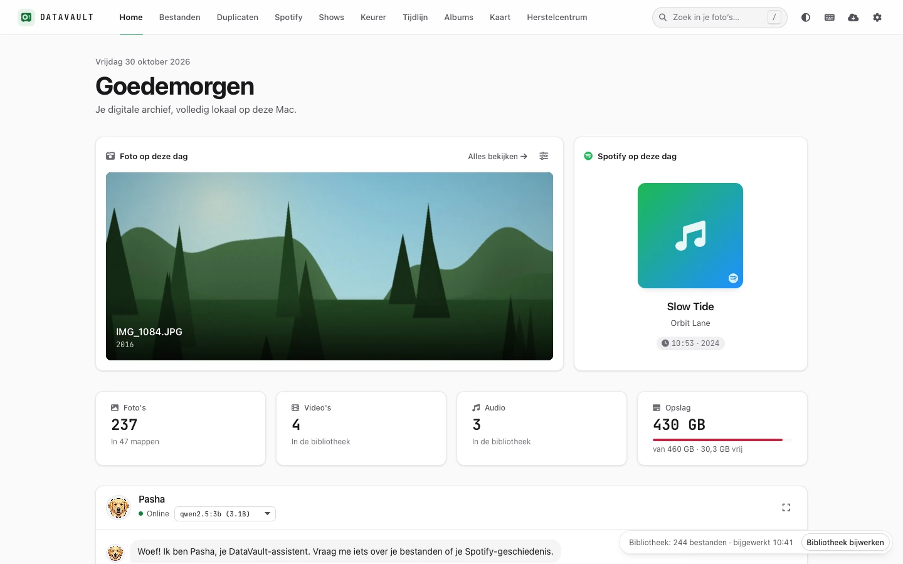

## The problem

A decade of photos ends up spread over disks, phone backups and exports: exact copies, bursts of
near-identical shots, scans without a date, folders nobody remembers. Cloud services solve this by
uploading everything. For an irreplaceable archive that is the wrong trade: you want search and
clean-up without handing the files to anyone, and without a tool that can lose them.

DataVault is built for one person with one big archive on an external disk (the design target is
100,000+ files). Every design decision follows from two rules: **nothing leaves the machine** and
**nothing is ever deleted**.

## What makes it interesting technically

- **Fully local.** No cloud, no telemetry, no CDN. Fonts, icons, map data and the map library are vendored. A test scans the frontend and fails on any external URL (one opt-in exception, see [Safety](#safety-design)).
- **Safe, reversible file operations.** One function moves archive files (`move_no_overwrite`). It never overwrites, keeps all metadata and records an undo. There is no delete in the app.
- **Background jobs** with progress, pause, cancel and resume. They survive a restart and wait when the disk is unplugged.
- **Incremental library index** (SQLite): 100,000 files are read once in about 14 seconds. A re-check of an unchanged archive takes 0.03 s, because only changed folders are listed.
- **Semantic photo search on-device.** A SigLIP 2 model runs through `onnxruntime` (Core ML on Apple Silicon). Search for "a dog on the beach" in Dutch or English. No PyTorch, no GPU server.
- **Perceptual-hash series.** dHash and pHash group bursts and near-duplicates, then "best of series" picks a keeper using a sharpness and exposure quality score.
- **Offline map.** Photos with GPS on a Natural Earth basemap, marker clusters and Dutch city labels. Place names are looked up offline. Online map tiles are an off-by-default opt-in.
- **Local LLM assistant ("Pasha")** through Ollama. It can search, filter and show photos. Anything that changes files is only a *proposal*: nothing happens until you click *Uitvoeren*. Actions use Ollama's own tool calling, with tags in the text as the fallback ([docs/PASHA_TOOLS.md](docs/PASHA_TOOLS.md)).
- **Schema migrations** (numbered, appended, tested against a legacy database) and automatic compact backups of the database.

**Motion language.** All motion follows one language, "Lichtval" ([docs/MOTION.md](docs/MOTION.md)). Durations, curves, springs (sampled into CSS `linear()`), distances and the stagger rhythm are tokens in `style.css`, and `motion.js` provides interruptible helpers: shared elements, FLIP, staggers, view transitions and number tickers. Photos are never zoomed or tilted for effect. Fast keyboard flows (the Keurer, the Elo duel and the viewer's next and previous) answer in the next frame. Instellingen > Beweging has three modes: Volledig, Rustig (short fades only, also chosen automatically when macOS asks for less motion) and Uit. `code/tests/ui/motion_perf.py` measures frame timing in WebKit, and its `--calm-sweep` checks that nothing slides, scales or rotates in Rustig.

**Ranking photos.** "Welke is mooier?" ranks photos from pairwise choices ([docs/ELO.md](docs/ELO.md)). Each photo has a Glicko-2 rating with an uncertainty, so new photos settle in a few comparisons and settled ones barely move. Each next pair is drawn by how much one choice would shrink both photos' uncertainty, without recent pairs, copies, bursts or near-duplicates. Every comparison can be undone exactly. In simulation the new method needs 15 to 45% fewer comparisons than the original fixed-K Elo to reach the same accuracy. The Ranglijst shows each photo's 95% band and how settled the ranking is. The range can be the whole library, a show or a smart album (`c` opens the collection picker).

## Features

**Browse and find**
- Home with a photo and a Spotify play from this day in earlier years, and quick entries to the rest
- Bestanden: folder tree, grid and list, a viewer with zoom, capture date, camera, size and place
- Tijdlijn: virtual-scrolled timeline of the whole archive with a year slider
- Albums: combined filters (period, folder, camera, type, location, rating), smart albums that update themselves, "Op deze dag"
- Slim zoeken: search by what is in the photo, "similar photos", file name search
- Kaart: photos on a map, clusters, year filter, "show on map" from the viewer

**Clean up (always undoable)**
- Duplicaten: exact copies by content hash, with a byte-for-byte check before anything moves
- Reeksen ("Beste uit reeks"): bursts and near-identical photos, keep the best, move the rest
- Herstelcentrum: one place to see every move the app made and put it back

**Curate**
- Keurer: swipe-style keep/move decisions with keyboard shortcuts, streaks and undo
- Shows: slideshows and "Welke is mooier?" duels that feed an Elo rating per photo, with a leaderboard
- Exporteren: copy a selection or the best photos of a period to a folder outside the archive (originals or resized JPEG, CSV/JSON overview)

**Your own data (DataGatherer, all opt-in)**
- Spotify (export or API), Last.fm, Google Takeout (location history, activity), Chrome and Safari history, iMessage and WhatsApp, with an activity timeline and photo geotagging from your location history. Nothing goes online unless you click it.

**Platform**
- Light and dark theme, full keyboard control, a shortcut overview, a design system with tokens, a style guide page
- Database back-ups with rotation and a restore script

## Screenshots

Light and dark theme at 1440 x 900, taken in WebKit from a **generated** showcase archive
(`code/tests/fixtures/showcase_vault.py`): no real photos or personal data.

| Screen | Light | Dark |
|---|---|---|
| Home |  | 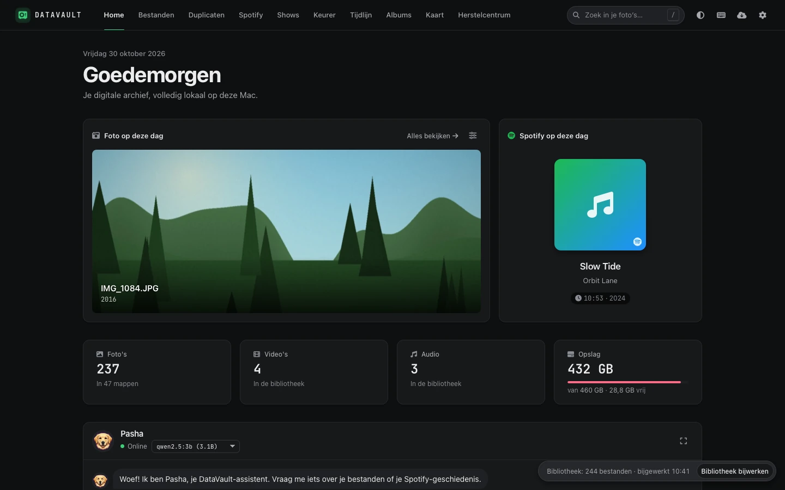 |
| Albums and filters | 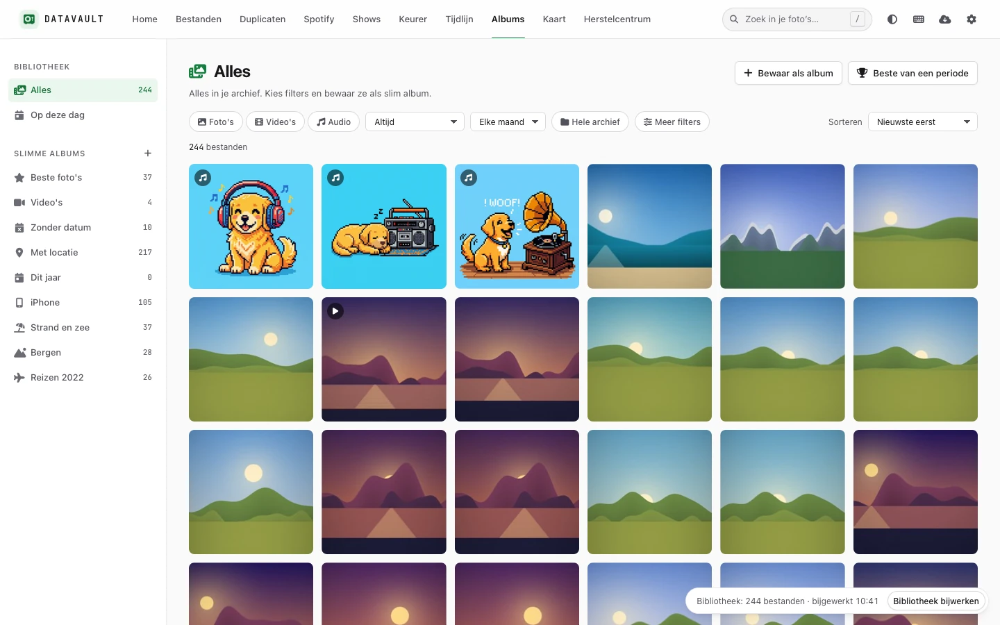 | 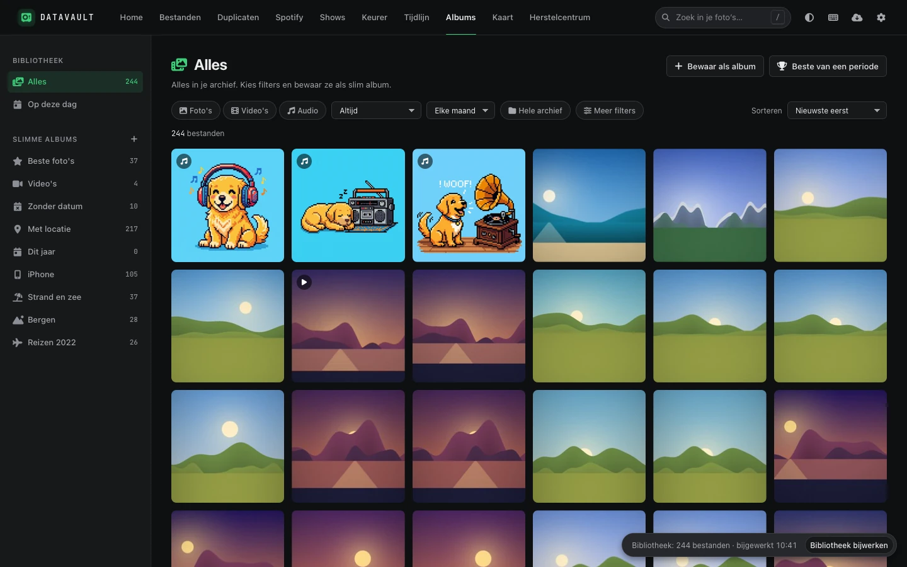 |
| Viewer with details | 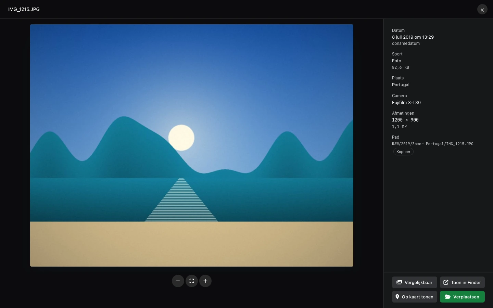 | 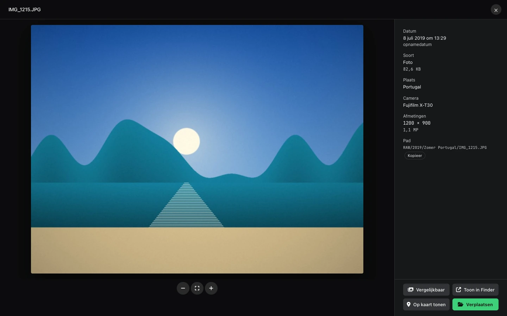 |
| Map (offline) | 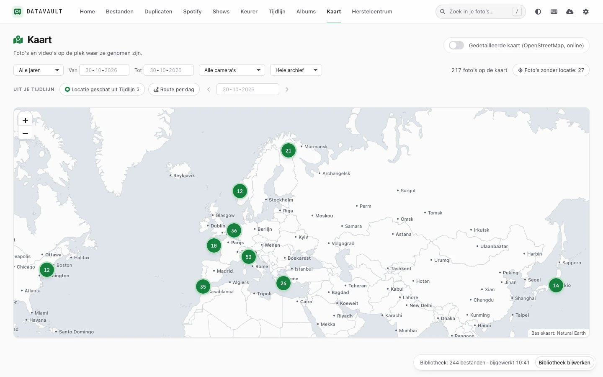 | 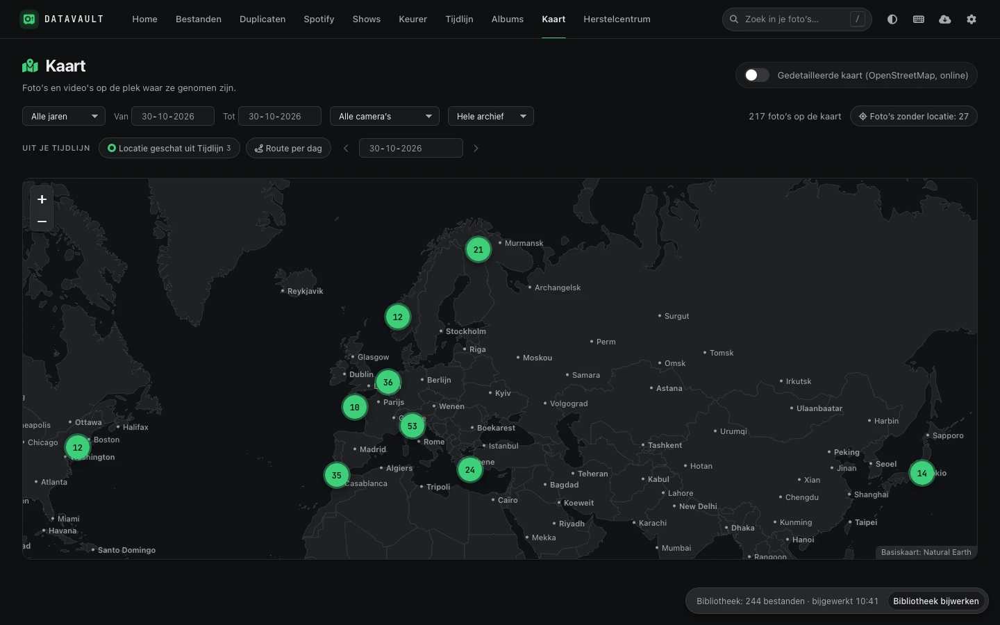 |
| Best of a burst | 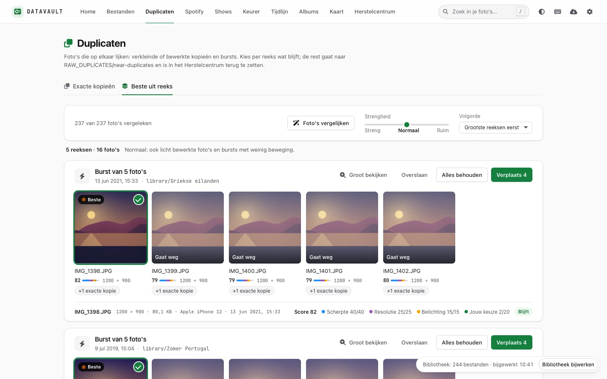 | 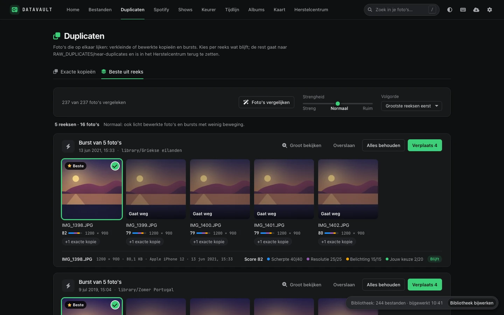 |
| Keurer | 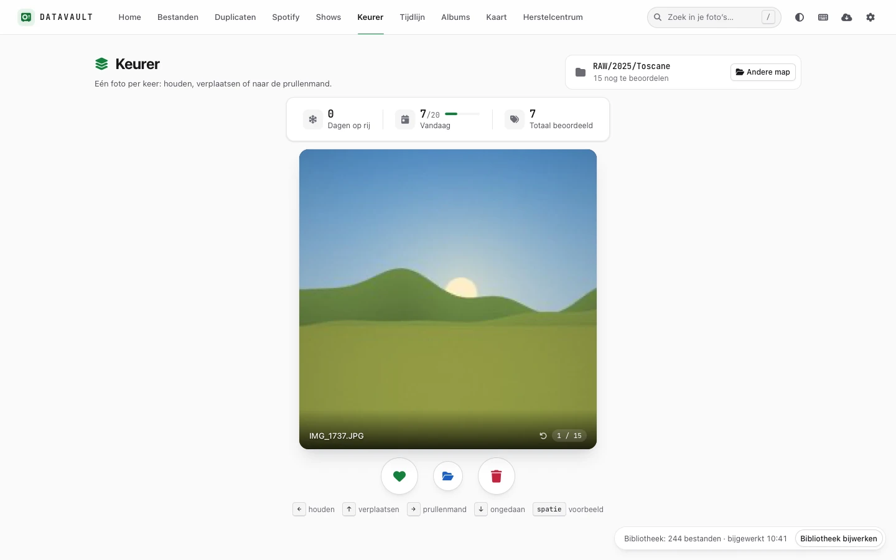 | 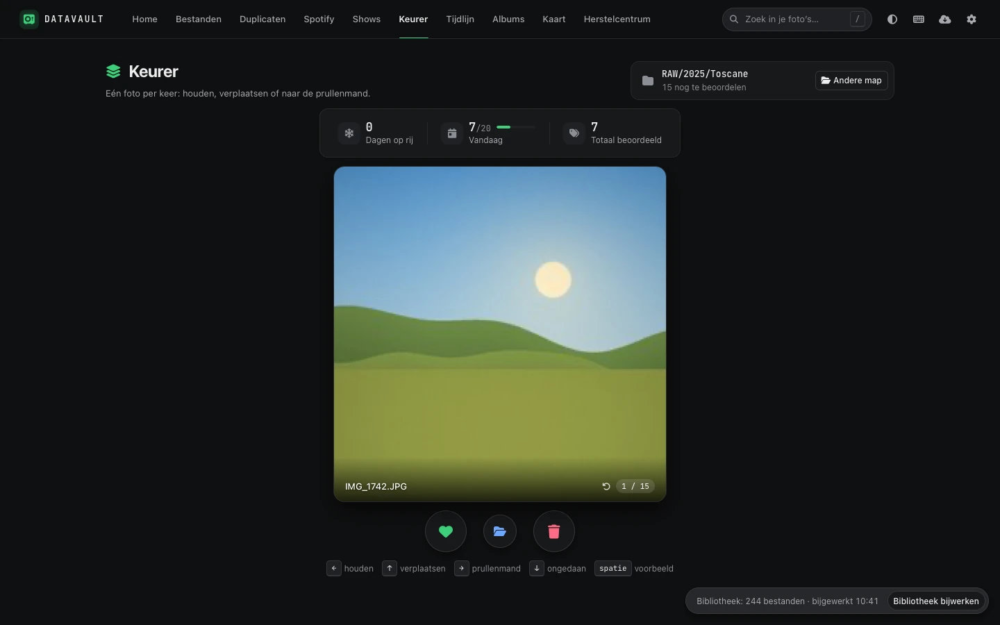 |
| Timeline | 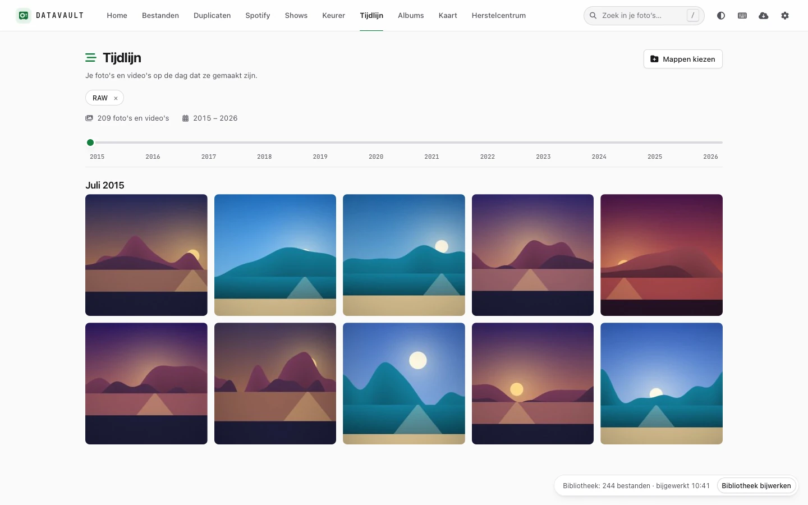 | 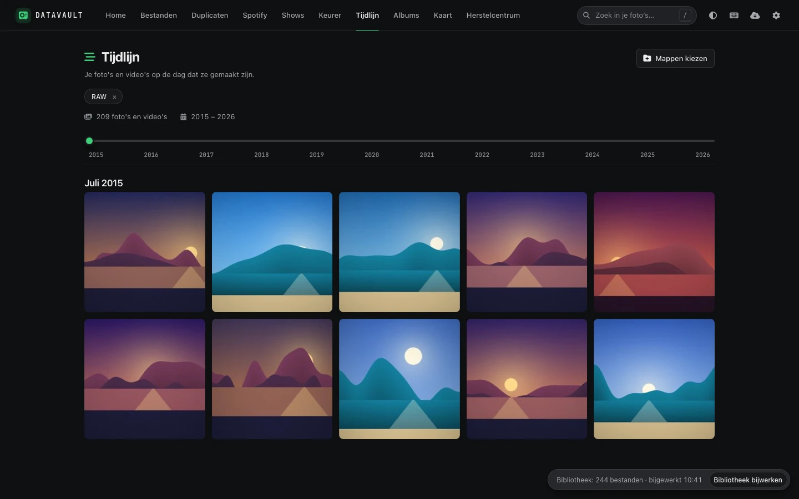 |
| Spotify | 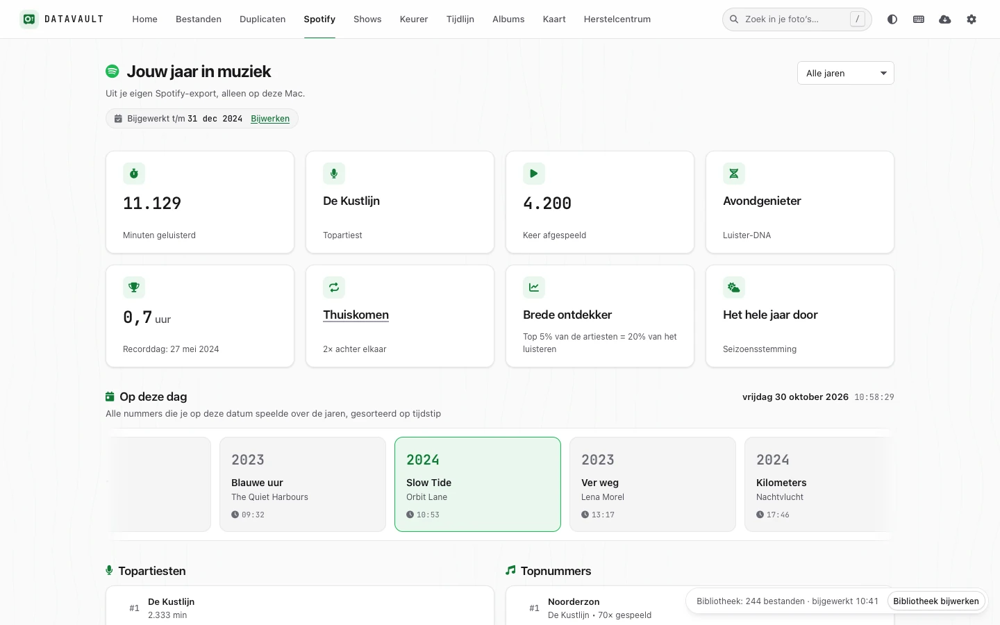 | 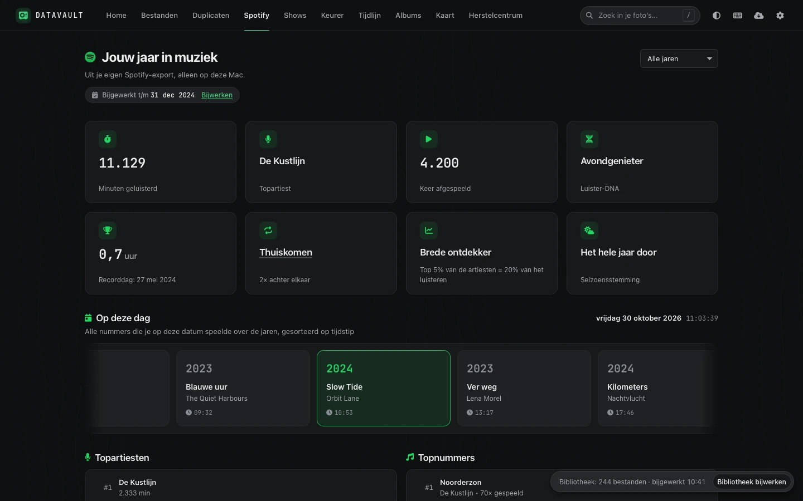 |

Screens that do not have a committed screenshot yet (placeholders, not invented images):

| Screen | Light | Dark |
|---|---|---|
| Pasha, the assistant | _screenshot pending_ | _screenshot pending_ |
| Slim zoeken (results) | _screenshot pending_ | _screenshot pending_ |
| Herstelcentrum | _screenshot pending_ | _screenshot pending_ |
| Duplicaten | _screenshot pending_ | _screenshot pending_ |
| DataGatherer | _screenshot pending_ | _screenshot pending_ |

<!--
TODO(screenshots): capture these from the showcase vault (see "Running the tests" for how to start it:
`code/tests/fixtures/showcase_vault.py DIR --populate URL`), WebKit, nl-NL, 1440x900, light and dark,
and save as .webp next to the others. Then replace the "screenshot pending" cells with the image links.

| docs/screenshots/pasha-light.webp / pasha-dark.webp            | Chat (Pasha) open with an answer that shows a strip of thumbnails and a proposal card with an "Uitvoeren" button |
| docs/screenshots/slim-zoeken-light.webp / slim-zoeken-dark.webp | Search window after typing a query such as "strand", with the results grid and relevance badges |
| docs/screenshots/herstelcentrum-light.webp / -dark.webp         | Herstelcentrum, tab "Herstel" with several entries (a move, a duplicate run) and one expanded |
| docs/screenshots/duplicaten-light.webp / -dark.webp             | Duplicaten after a scan of a folder: groups, the keeper rule picker and the kept copy highlighted |
| docs/screenshots/datagatherer-light.webp / -dark.webp           | DataGatherer overview with source cards (Spotify, Google Takeout, Chrome, Berichten) and one imported |
-->

## Architecture

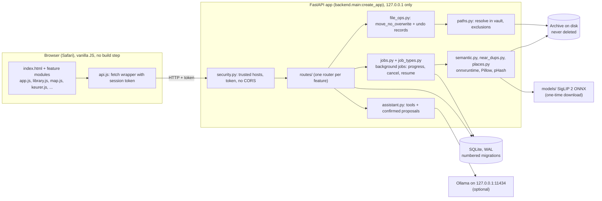

- **Frontend:** vanilla JavaScript, one module per screen, `dom.js` builds elements with `textContent` (never `innerHTML` with data), all colours and spacing come from CSS tokens in `style.css`. FontAwesome, JetBrains Mono, Leaflet and the Natural Earth map data are vendored.
- **Backend:** FastAPI, built by a factory so tests get a fresh app per vault. One router per feature. A thread-local SQLite connection per thread (WAL). Long work runs as a job, never on the event loop.
- **Jobs:** `JobManager` persists jobs in SQLite. They report progress, can be paused, cancelled and resumed, are marked "interrupted" after a crash and enter `waiting_for_vault` when the disk disappears.
- **Library index:** `media` table with capture date, size, camera, GPS and duration, read from file headers without decoding pixels. Folder mtimes decide what to re-read. Albums, timeline, map, export and the assistant all query it.
- **Migrations:** `migrations.py` holds numbered migrations, numbered in blocks per feature (the latest is 110). Existing ones are never edited. A backup of the database is made before a migration, and tests run each against a legacy database to prove that ratings, decisions, undo data and jobs survive.

## Safety design

The archive is irreplaceable, so the app is built to be unable to lose it.

- **Never delete.** There is no code path that removes an archive file. The Keurer's "weg" moves a file to a trash folder, duplicates move to `RAW_DUPLICATES`, series moves go to a visible folder. Nothing is emptied automatically.
- **One way to move.** `file_ops.move_no_overwrite` is the only function that moves archive files. It refuses to overwrite (a name clash gets `_DUP_001`), keeps timestamps, EXIF and extended attributes, refuses cross-device moves instead of copy-then-delete, and works under one lock so concurrent moves cannot collide.
- **Undo for every move.** Each move is recorded (run id, source, destination, inode and size) so the Herstelcentrum can put it back. Restoring never overwrites either, and the Keurer checks that the file is still the same one.
- **Byte-for-byte before duplicates move.** A hash match alone is not enough.
- **Path validation.** Every path from the browser is resolved inside the vault (symlinks, `..` and differently-cased protected folders included). The cache, database and trash folders are excluded centrally in `paths.py`.
- **Local only.** The server listens on `127.0.0.1`, accepts only trusted `Host` headers (DNS rebinding), sends no CORS headers, and every POST needs a per-session token in `X-DataVault-Token`.
- **Offline by default.** Nothing calls out on its own. The only opt-ins are online map tiles (one URL template, off by default), Spotify and Last.fm in DataGatherer (on click), the one-time model download, and a local Ollama.
- **The assistant cannot act on its own.** Pasha has no "delete" tool and no access outside the vault. Moves and exports are proposals that expire after ten minutes and run once, after your click, through the same safe function.
- **Reading your own data is gated.** Messages and browser history are read only from sources you switch on, and the server needs no Full Disk Access (a small helper you start yourself does).

## Install

Requirements: macOS, Python 3.12 (`brew install python@3.12`), optional `ffmpeg` for video thumbnails (`brew install ffmpeg`).

```bash
git clone https://github.com/matthewsamuel/DataVault.git
cd DataVault/code
python3.12 -m venv venv
venv/bin/pip install -r requirements.txt
cp config.example.json config.json     # then edit the paths to your archive (config.json is gitignored)
./start.sh                              # starts on http://127.0.0.1:8000 and opens the browser
```

Stop with `Ctrl+C` or `./stop_datavault.sh`. On macOS you can also double-click `DataVault.app`
(see `code/APP_BUNDLE_README.md`). Starting by hand:

```bash
venv/bin/python -m uvicorn --factory backend.main:create_app --host 127.0.0.1 --port 8000
```

**Optional: semantic search model** (about 970 MB, one explicit download; the app never downloads on its own):

```bash
venv/bin/python scripts/download_models.py --list   # shows files, sizes and sources first
venv/bin/python scripts/download_models.py          # downloads and checks SHA-256 per file
```

The same step is the *Zoekmodel installeren* button in Instellingen. Then run the *Slim zoeken* indexing job from the app.

**Optional: assistant.** Install [Ollama](https://ollama.com), then `ollama pull qwen2.5:3b` (the default model, also selectable in the chat).

Try it without your own archive: build a generated demo vault and point the app at it.

```bash
cd code
V=$(mktemp -d)/vault
venv/bin/python tests/fixtures/showcase_vault.py $V        # writes ${V}_config.json
DATAVAULT_TESTING=1 DATAVAULT_CONFIG=${V}_config.json \
  venv/bin/python -m uvicorn --factory backend.main:create_app --host 127.0.0.1 --port 8765
```

## Running the tests

```bash
cd code
venv/bin/pip install -r requirements-dev.txt
venv/bin/python -m pytest                    # backend and static frontend tests, on a generated test vault
python3 tests/ui/smoke_webkit.py             # browser smoke test in WebKit (needs: pip install playwright && playwright install webkit)
```

pytest never touches your archive: every test builds a throwaway vault, and the chat tests use a fake Ollama.
The smoke test starts its own server, clicks through every screen in both themes and fails on any JavaScript
error, failed request, WCAG AA contrast problem or control without a name. More in `code/README.md`.

## Performance

Measured on an Apple M3 Pro, internal SSD, on synthetic vaults (not the real archive). Numbers are from the step reports in `CHANGELOG.md`.

| What | Result |
|---|---|
| Cold index of 100,000 files in 2,082 folders | 13.9 s (about 7,200 files/s); `/api/health` stayed at p50 5.8 ms, p95 9.0 ms; server RSS 64 to 81 MB |
| Re-check of the unchanged archive | 0.03 s incremental, 0.77 s for a full pass over all folders |
| Timeline from the index, 96,878 rows | first page 186 ms over HTTP, all rows 420 ms (the old directory walk: 11.7 s cold) |
| Browse a filtered album page, 100,000 rows | first pages 6 to 98 ms, deep page at offset 50,000 66 to 141 ms |
| "On this day" from the index | 43 ms |
| Semantic search, 100,000 vectors | a new query 66 ms, similar photos 31 ms, repeated query 0.3 ms |
| Semantic search, first query after start | 1.4 s with the model files in the OS cache (10 to 20 s when read cold from the external disk) |
| Image embedding (SigLIP 2) | 71 img/s with Core ML and thumbnails, about 10 img/s on the CPU |
| Burst and near-duplicate analysis | 391 photos/s end to end (4,026 photos in 10.3 s); 12 MP JPEG 130/s on 4 threads |
| Recovery list in a worst case (10,000 Keurer moves, 100 runs of 2,000 files) | 223 ms for 50 entries (was 47.9 s) |
| Database backup, 109 MB database | 6.7 MB gzipped, made in about 1 s |

## Project structure

```
.
├── README.md  CHANGELOG.md  docs/            documentation, screenshots, "Bewust niet gedaan"
├── DataVault.app/                            double-click launcher (compiled AppleScript)
└── code/
    ├── backend/
    │   ├── main.py, config.py, security.py, errors.py     app factory, config, token and host checks, uniform errors
    │   ├── database.py, migrations.py                     SQLite (WAL) and numbered migrations
    │   ├── file_ops.py, paths.py                          the only file mover, vault path rules
    │   ├── jobs.py, job_types.py                          background jobs and their types
    │   ├── media_index.py, media_meta.py, media_dates.py  library index and metadata readers
    │   ├── library_filters.py, smart_albums.py            filters and smart albums
    │   ├── semantic.py, near_dups.py, places.py           CLIP search, series, offline place names
    │   ├── assistant.py, elo.py, export.py, backup.py, recovery.py
    │   ├── datagatherer/                                  Spotify, Takeout, browsers, messages
    │   └── routes/                                        one API router per feature
    ├── frontend/                                          index.html, one JS file per screen, style.css, vendor/
    ├── scripts/                                           download_models.py, eval_semantic_search.py
    ├── tests/                                             pytest suite, fixtures (test and showcase vault), ui/smoke_webkit.py
    ├── requirements.txt  config.example.json  start.sh  stop_datavault.sh  restore_backup.py
    └── README.md  RESTART.md  APP_BUNDLE_README.md       Dutch user documentation
```

## Limitations

- macOS only (launcher, Finder integration, Core ML). The backend itself is portable Python, but this is untested elsewhere.
- Built for one user on one machine: no accounts, no sharing, no sync. Two servers on one archive are not supported.
- The UI is in Dutch. There is no language switch.
- Video has no near-duplicate detection, and capture dates for avi, mkv and mts fall back to the file date.
- RAW thumbnails go through macOS `sips` and are not tested with real camera RAW files.
- The semantic model needs about 1.7 GB of RAM while loaded and a 970 MB download; the first query after a reboot reads it from disk (10 to 20 s from an external disk).
- Semantic search does not understand negation: "a beach without people" finds beaches with people. The search window says so.
- The small local chat model (`qwen2.5:3b`) picks the right action for 97 percent of 45 test requests (92 percent of those phrased differently from its examples), so Pasha still sometimes asks you to rephrase ([docs/PASHA_TOOLS.md](docs/PASHA_TOOLS.md)).
- The map labels cities, not countries (countries appear as tooltips).
- The test suite and the measurements ran on generated archives, never on the real one.
- There is no LICENSE file yet.

The full, honest list with reasons and good next steps is in [docs/NIET_GEDAAN.md](docs/NIET_GEDAAN.md).

## Author

Matthew Samuel. Built with FastAPI, SQLite, vanilla JavaScript, Pillow, onnxruntime and Ollama.
